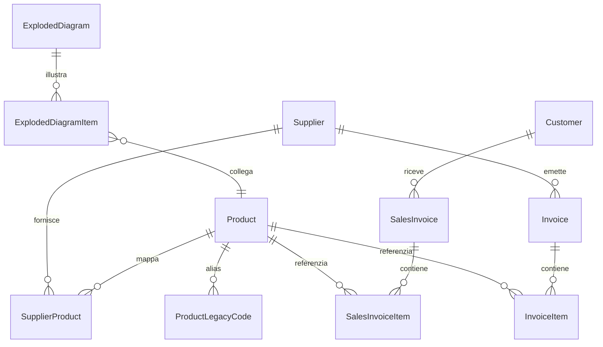

# Gestionale Officina Meccanica Angeleri — Sintesi di Sviluppo, Changelog & Roadmap

> **Documento Ufficiale di Sintesi e Architettura Tecnica**  
> **Versione Corrente:** v4.0.0 — Novembre 2026  
> **Repository GitHub:** [officina-angeleri/gestionale-angeleri-new](https://github.com/officina-angeleri/gestionale-angeleri-new)  
> **Target LLM & Documentazione:** Ideale per consultazione tramite Google Gemini / Assistenti AI per allineamento rapido sull'intero ecosistema del gestionale.

---

## 1. Panoramica Esecutiva del Progetto

Il **Gestionale Angeleri** è la piattaforma applicativa desktop centrale per l'analisi costi, la tracciabilità delle forniture, la gestione dei clienti, la consultazione tecnica degli esplosi macchine e l'integrazione contabile-commerciale di **Officina Meccanica Angeleri s.r.l.** (Vigevano, PV).

L'applicazione integra in un unico hub:
1. **Storico Acquisti Fornitori**: Analisi di oltre 7.550 fatture d'acquisto, prezzi storici, sconti reali e codici fornitore.
2. **Storico Vendite Clienti**: Archivio storico dal 2019 ad oggi con oltre 12.900 fatture di vendita ai clienti (prezzi applicati, sconti, articoli venduti).
3. **Catalogo Magazzino Master**: Oltre 4.800 articoli interni con categorizzazione per lavorazione e codici unificati.
4. **Esplosi Macchine & Distinte Tecniche PDF**: Oltre 170 tavole tecniche PDF con corrispondenza automatica tra numerazione storica esploso e nuovo codice master.
5. **Integrazione Cloud B-Kode (Bidirezionale)**: Sincronizzazione automatica e manuale di listini, nuove fatture, anagrafica articoli fornitori (`mgafoList`) e scrittura istantanea da gestionale a cloud (`mgafoForm`).
6. **Assistente AI Intelligente per Officina (Gemini Flash / Pro)**: Chat contestuale collegata in tempo reale al database centrale, con comprensione delle logiche meccaniche dell'officina, calcolo costi spezzoni barre/materiali, dettatura vocale e link interattivi ai documenti.

---

## 2. Stack Tecnologico & Architettura di Rete

| Componente | Tecnologia / Configurazione | Note Operative |
|---|---|---|
| **Linguaggio & Runtime** | Python 3.13 (64-bit) con ambiente virtuale locale (`venv`) | Avvio rapido via `avvia.bat` |
| **Framework Grafico** | PyQt6 (Modern GUI, Multi-Thread, Responsive Layout) | Threading `QThread` per sync non bloccante |
| **Database Centrale** | PostgreSQL 13+ ospitato su NAS Synology DS920+ (`angeleri_db`) | Pooling SQLAlchemy, lock distribuito di sync |
| **ORM & Query Engine** | SQLAlchemy 2.0+ con caricamento ottimizzato (`joinedload`, `selectinload`) | Risolte query N+1, latenza < 0.05s |
| **Cloud ERP** | B-Kode Cloud (ExtJS / CodeIgniter multi-tenant) | Connessione via reverse-engineered REST/JSON API |
| **Intelligenza Artificiale** | Google GenAI SDK (`google-genai`) — Gemini 2.5 Flash / Pro | Multi-tool Function Calling sul DB aziendale |
| **Storage Documentale** | NAS `\\angeleri_new\Pubblica\Database\Fornitori` e `Fatture_Clienti` | XML SDI FPR12 / FPA12, PDF nativi e scansionati |
| **Build & Deploy** | PyInstaller via `build_exe.py` | Distribuzione binari compilati `.exe` sul NAS |

---

## 3. Regole di Codifica e Nomenclatura Officina

Il sistema adotta un modello ibrido che collega i vecchi cataloghi cartacei ai moderni gestionali:
1. **Prefisso `A` (es. `A850-0050`, `A650-0001`, `A550-...`)**:
   Componenti commerciali di acquisto esterno (motori, cinghie, pignoni commerciali, cuscinetti, minuteria, pneumatica).
2. **Prefisso `L` (es. `L010-...`, `L011-...`, `L040-...`, `L050-...`)**:
   Particolari a disegno di produzione/lavorazione interna:
   - `L010`: Particolari torniti/fresati in alluminio (rulli superiori, camicie, piastre).
   - `L011`: Particolari in acciaio/ferro (alberi, perni, bussole).
   - `L040`: Carpenteria metallica e saldatura.
   - `L050`: Semilavorati e ingranaggi speciali (ingranaggi in fibra, pignoni speciali con trattamenti).
3. **Codici Numerici Legacy (es. `3150-12`, `3100-20`, `00ICT60-01`)**:
   Identificativi storici presenti sulle tavole esplose delle macchine Angeleri (Incollatrici MAV 3150, ICT 60, ECOL 60, MAV 3024, TERMO 450, ecc.). Mappati `N:1` con i nuovi codici master `A` o `L`.

---

## 4. Modello Dati (Schema Database PostgreSQL)

### Tabelle Principali:
- `suppliers`: Anagrafica fornitori (824 censiti), P.IVA, note contabili.
- `customers`: Anagrafica clienti storici (oltre 500 clienti), P.IVA / C.F., indirizzo.
- `invoices`: Testate fatture elettroniche di acquisto fornitore (7.550 record).
- `invoice_items`: Righe di acquisto estratte da XML SDI (codice fornitore, descrizione, quantità, prezzo unitario netto, sconto, totale riga).
- `sales_invoices`: Testate fatture elettroniche di vendita clienti (12.977 record dal 2019 al 2026).
- `sales_invoice_items`: Righe di vendita ai clienti con prezzi applicati storici.
- `products`: Anagrafica catalogo master Angeleri (codice, descrizione, categoria, costo standard, prezzo listino, coefficiente di conversione kg/m).
- `supplier_products`: Corrispondenze tra codice articolo del fornitore e codice master interno Angeleri (sincronizzato con `mgafo` di B-Kode).
- `product_legacy_codes`: Tavola di raccordo tra numerazioni storiche delle macchine e codici master correnti.
- `exploded_diagrams` & `exploded_diagram_items`: Tavole tecniche PDF e posizioni componenti con coordinate e riferimenti tecnici.
- `sync_status`: Registro sincronizzazioni background e lock distribuito anti-concorrenza tra PC d'officina.

---

## 5. Changelog Cronologico delle Versioni

### v4.0.0 — Novembre 2026 (Release Corrente)
* **Nuova Scheda Fornitori 360° & Ricerca Articoli in Fattura (`SuppliersWidget`)**:
  - Aggiunta ricerca rapida articoli fatturati sia contestuale al singolo fornitore sia globale su tutti i fornitori.
  - Visualizzazione istantanea di quantità, prezzo unitario, totale spesa riga, data e numero fattura d'origine.
  - Apertura con doppio click del visualizzatore documento PDF/XML nativo.
  - Dialogo dedicato `ProductLinkDialog` per associare con un click qualsiasi riga fornitore al codice interno Angeleri.
* **Integrazione B-Kode Bidirezionale (Scrittura Diretta API)**:
  - Reverse engineering del modulo `mgafoForm` di B-Kode Cloud.
  - Implementazione endpoint `save_bkode_supplier_article`: quando l'utente associa un articolo in officina, la modifica viene inviata ed inserita istantaneamente su B-Kode Cloud (`panel/dbform`) con payload serializzato PHP nativo.
* **Ottimizzazione Prestazioni UI (Zero-Lag)**:
  - Eliminato il ricaricamento forzato sincrono ad ogni cambio di scheda (`switch_view`).
  - Ottimizzato il caricamento delle tabelle Qt con `setUpdatesEnabled(False)` durante il popolamento, riducendo i cicli di redraw.
  - Aggiunto timer debounce di 250ms sulla ricerca testuale per evitare query continue durante la digitazione.
  - Eager loading SQLAlchemy (`joinedload` / `selectinload`) eliminando 800+ query N+1 (catalogo e dettaglio fornitore 30x più veloci).
* **Risoluzione Anomalia "Fattura non trovata / righe vuote"**:
  - Implementato algoritmo di risoluzione multi-livello per `InvoiceDetailDialog`: gestione delle discrepanze di spaziatura nei numeri fattura dei fornitori (es. `V1 532/26` vs `V1  532/26` o `V1532/26`).
  - Prioritizzazione automatica delle fatture con articoli completi rispetto ai record preliminari solo-testata.
  - Aggiornamento dei link dell'Assistente AI con inclusione dell'ID numerico univoco del database.
* **Nuovo Popup di Sincronizzazione B-Kode**:
  - Eliminata la dicitura ambigua con zeri (`0, 0, 0, 0`): ora il sistema conferma esplicitamente che il database è già allineato al 100% con B-Kode Cloud e visualizza il riepilogo totale di fatture e articoli archiviati.

---

### v3.5.0 — Ottobre 2026
* **Assistente AI Intelligente Officina Angeleri (Gemini Flash & Pro)**:
  - Interfaccia conversazionale integrata (`AIAssistantWidget`) con supporto per dettatura vocale microfonica.
  - Integrazione multi-tool sul database PostgreSQL:
    * `cerca_tutti_articoli`, `cerca_ricambio_360`, `confronta_elenco_ricambi`.
    * `storico_prezzi_fornitore`, `storico_vendite_cliente`.
    * `dettaglio_completo_fattura`, `elenco_fatture`.
    * `cerca_esploso_macchina`, `dettaglio_fornitore`, `dettaglio_cliente`, `statistiche_generali_officina`.
  - Calcolatore integrato costo spezzoni materiale grezzo (alluminio, ottone, acciaio) convertendo mm → metri → kg → costo fornitore.
  - Link cliccabili nel testo delle risposte per aprire istantaneamente le fatture o i disegni tecnici a schermo.

---

### v3.0.0 — Settembre 2026
* **Sincronizzazione Automatica B-Kode Cloud**:
  - Implementazione client HTTP di sessione `BKodeClient` con gestione cookie `ci_session` e login automatico con cifratura password.
  - Engine di sincronizzazione `BKodeSyncEngine`: estrazione listini di acquisto (`lisforList`, `lisforListR`), listini di vendita (`liscliList`, `liscliListR`), articoli a catalogo (`mgartList`) e download fatture elettroniche.
  - Sistema di locking distribuito su tabella PostgreSQL per evitare conflitti tra più postazioni attive in officina.
  - Icona di stato e pulsante rapido sincronizzazione nella status bar del gestionale.

---

### v2.5.0 — Giugno / Luglio 2026
* **Modulo Esplosi Macchine & Distinte Tecniche PDF**:
  - Archiviazione e indicizzazione di 170+ disegni e tavole tecniche delle macchine Angeleri.
  - Visualizzatore PDF integrato e apertura a tutto schermo dei disegni originali.
  - Mappatura interattiva tra la posizione sul disegno (`NUMERAZIONE_OLD`) e il codice master `A`/`L`.

---

### v2.0.0 — Marzo / Maggio 2026
* **Migrazione a PostgreSQL su NAS Synology DS920+**:
  - Transizione da SQLite a PostgreSQL centrale per accesso multi-utente contemporaneo senza lock di file.
  - Introduzione del modulo Clienti e importazione di oltre 12.900 fatture di vendita storiche.
  - Finestra `InvoiceDetailDialog` unificata (supporto sia per fatture d'acquisto che per fatture di vendita con layout moderno, badge colorati e affiancamento a schermo diviso).

---

### v1.1.0 — Febbraio 2026
* Aggiunta ricerca articoli avanzata con filtro fornitore.
* Prima versione della finestra `InvoiceDetailDialog` per visualizzazione testata e righe.
* Script di normalizzazione e merge per anagrafiche duplicate (`MATTI SRL`, `ALUSIC`).

---

### v1.0.0 — Febbraio 2026
* Struttura iniziale dell'applicazione in PyQt6 con SQLite locale.
* Parser XML SDI FPR12 con gestione namespace flessibile.
* Algoritmo di scorporo sconti commerciali (Alusic / TipoCessionePrestazione=SC) per calcolo del prezzo unitario reale.
* Filtro delle righe tecniche di rumore SDI (CONAI, note di consegna, righe descrittive).

---

## 6. Roadmap di Sviluppo Futuro

| Priorità | Modulo / Obiettivo | Descrizione Funzionale |
|:---:|---|---|
| 🟢 **Alta** | **Giacenze di Magazzino & Scorte Minime** | Monitoraggio delle scorte fisiche per ricambi commerciali (cuscinetti, cinghie, raccorderia) con calcolo punto di riordino automatico. |
| 🟢 **Alta** | **Modulo Commesse Officina Avanzato** | Aggancio diretto tra righe fattura d'acquisto materiale (es. barre trafilate, fusioni) e commesse di montaggio macchine. |
| 🟡 **Media** | **Stampa Barcode / QR Code per Cassettiere** | Generazione di etichette barcode per i codici master `A` ed `L` da applicare alle cassettiere in officina per scansione rapida. |
| 🟡 **Media** | **Export Listini Prezzi Personalizzati** | Esportazione automatica di preventivi e listini clienti in Excel/PDF con ricarico percentuale configurabile da interfaccia. |
| 🔵 **Bassa** | **Backup Cloud Automatizzato S3/Drive** | Replica programmata notturna dei dump PostgreSQL e dei PDF/XML su storage protetto off-site. |

---

## 7. Informazioni di Accesso e Consultazione

* **Visualizzazione Web su GitHub**:  
  https://github.com/officina-angeleri/gestionale-angeleri-new/blob/main/CHANGELOG_ROADMAP.md
* **File Raw per Gemini / LLM / API**:  
  https://raw.githubusercontent.com/officina-angeleri/gestionale-angeleri-new/main/CHANGELOG_ROADMAP.md
